# Intranet Municipal

Plataforma interna que reúne noticias, contactos, documentos y enlaces a sistemas municipales. La Mesa de ayuda permite solicitar soporte a Informática y seguir cada caso desde su creación hasta su cierre.

## Perfiles y permisos

El acceso se realiza con el RUT de una persona activa y el PIN de seis dígitos de su rol. El RUT identifica a la persona y el rol determina qué operaciones puede realizar. Los permisos que se describen a continuación corresponden a la configuración inicial y se pueden ajustar desde Administración.

Todos los perfiles pueden consultar las noticias publicadas, el directorio, los documentos y los enlaces activos. También pueden crear solicitudes de soporte y consultar el historial de sus propias solicitudes.

| Perfil | Funciones principales |
| --- | --- |
| **Funcionario** | Consulta los recursos internos. Crea solicitudes de soporte, agrega comentarios a sus casos y consulta su estado. Su pantalla de entrada es **Inicio**. |
| **Editor** | Además de las funciones del Funcionario, crea, edita, publica y archiva noticias. También sube, edita y elimina documentos. Su pantalla de entrada es **Noticias**. |
| **Informática** | Atiende solicitudes de todos los usuarios, asigna responsables, actualiza estados y registra soluciones. También administra los enlaces a sistemas municipales. Su pantalla de entrada es **Mesa de ayuda**. |
| **Administrador** | Tiene acceso a todos los módulos. Registra y gestiona personas, importa usuarios desde Excel o PDF con texto, configura permisos y PIN por rol, consulta la bitácora y genera respaldos. Su pantalla de entrada es **Administración**. |

## Capturas de pantalla

### Inicio de sesión

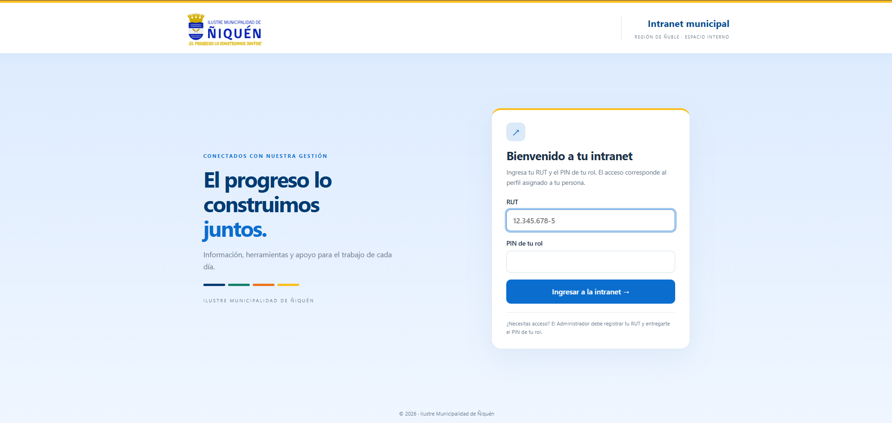

### Inicio del Funcionario

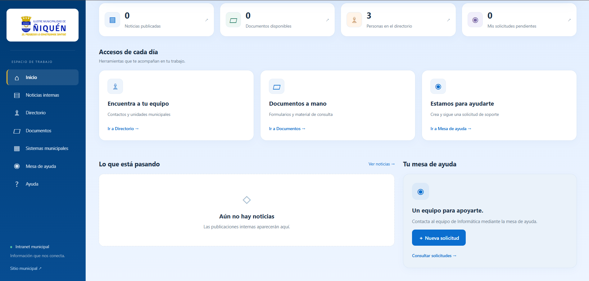

### Directorio municipal

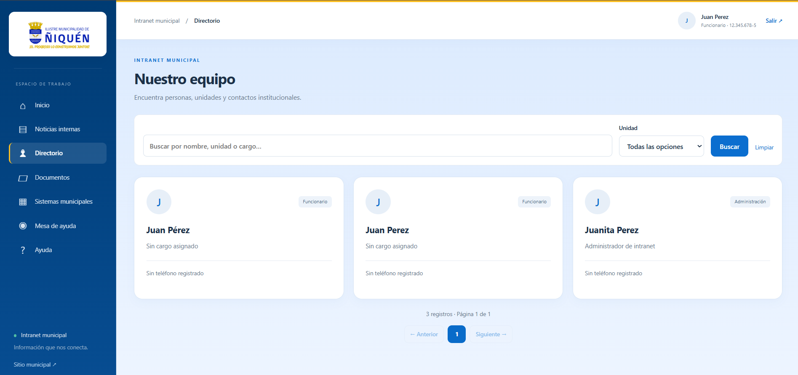

### Mis solicitudes

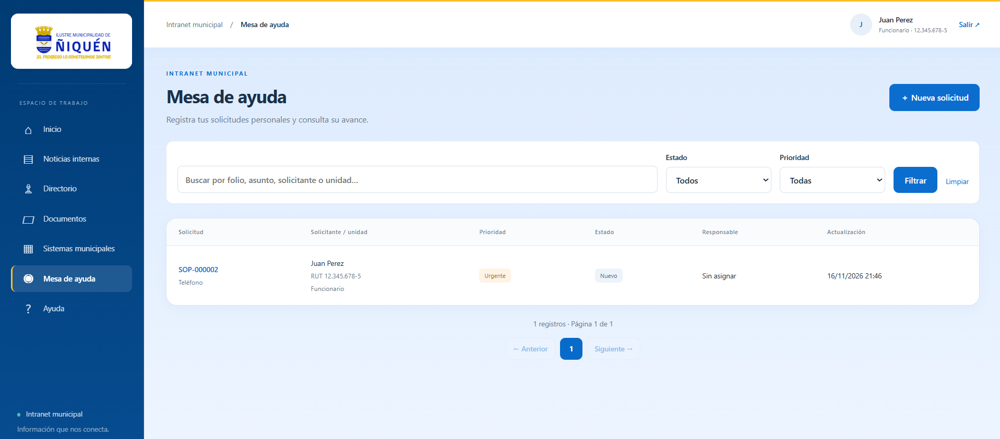

### Noticias del Editor

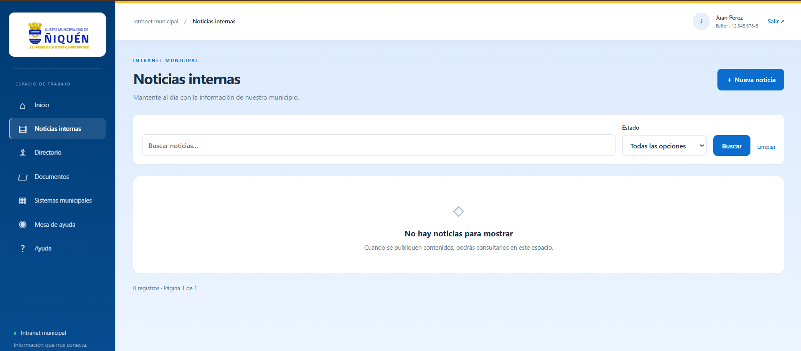

### Gestión de documentos

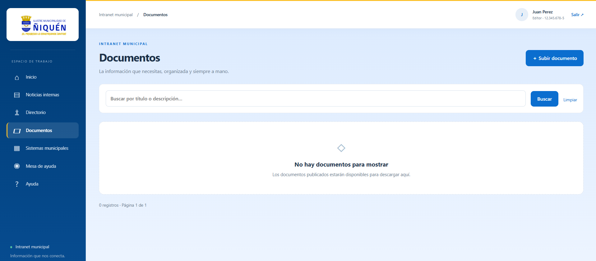

### Mesa de ayuda de Informática

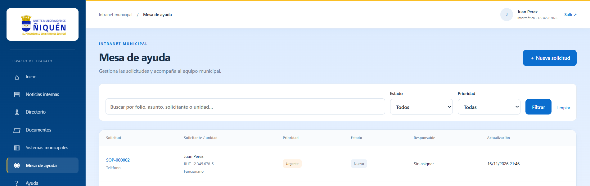

### Detalle de una solicitud

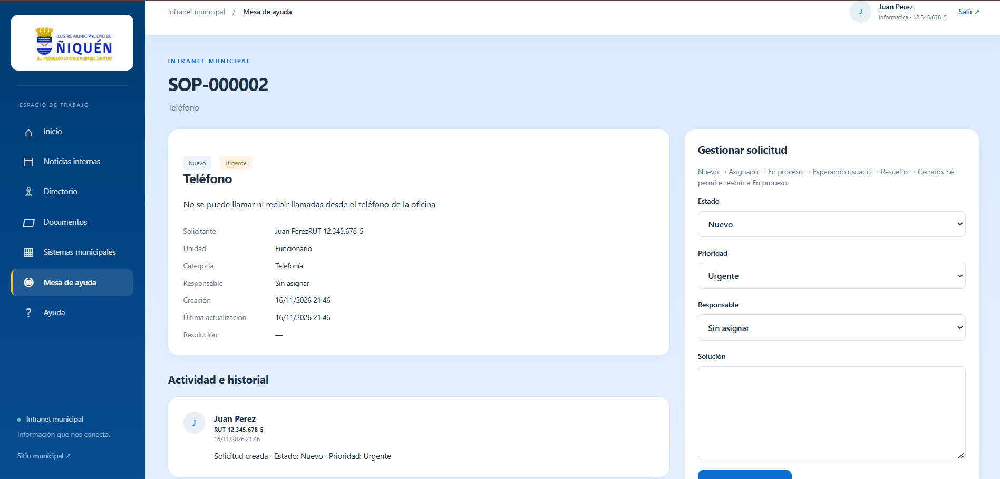

### Sistemas municipales

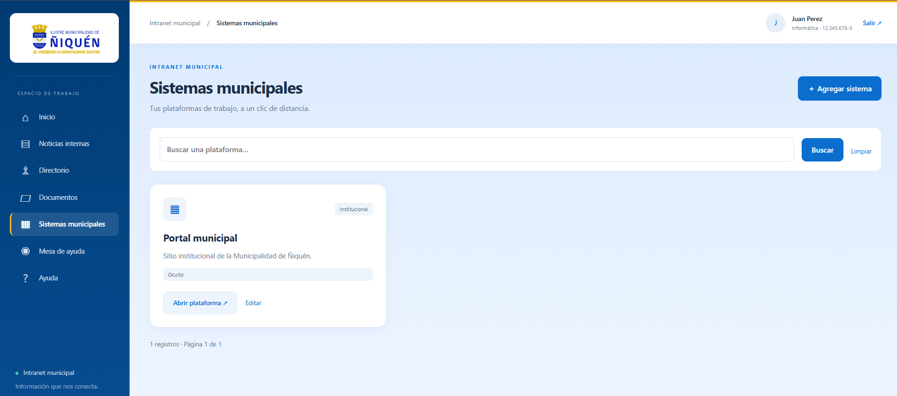

### Administración de personas

### Importación de personas

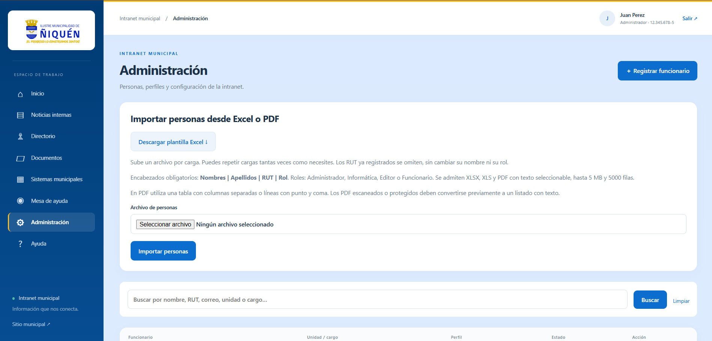

### Perfiles y permisos

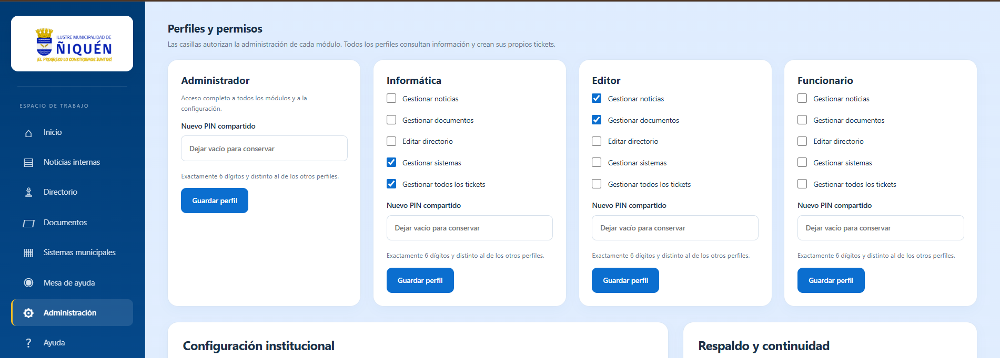

### Bitácora de actividad

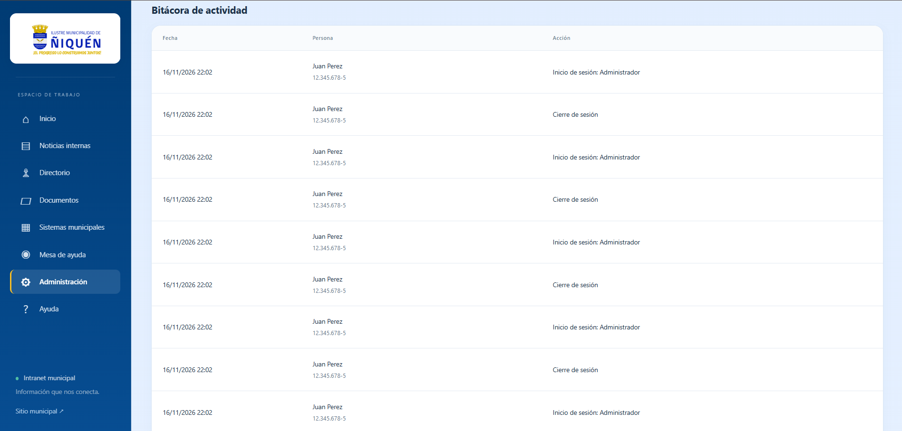
